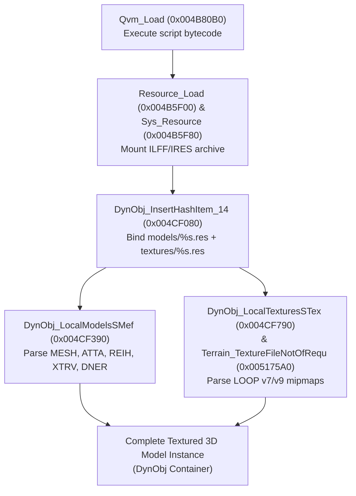

# Project I.G.I. (2000) Game Natives Call Reference Guide

> **Official Execution & Calling Guide for Disassembled Retail IGI.EXE Natives**  
> Source Reference: `/Users/haseeb-mir/Documents/Code/project-igi-natives/assets/BinaryNinja/natives/CLEAN/`  
> Target Architecture: 32-bit PE Intel x86 (Base `0x00400000`, Retail `IGI.EXE`)  
> Language: Modern C++20 / C11, Type-Safe, Copy-Paste Ready, Zero Raw Registers.

---

## Table of Contents

1. [Pipeline 1: Full 3D Model Loading (.QVM + .RES + .MTP + MEF + .TEX)](#1-pipeline-1-full-3d-model-loading-qvm--res--mtp--mef--tex)
2. [Pipeline 2: Level Terrain Loading (.HMP + .CTR + .TEX + .LMP + .BIT + .QSC)](#2-pipeline-2-level-terrain-loading-hmp--ctr--tex--lmp--bit--qsc)
3. [Pipeline 3: Frame Loop & QTask Engine Lifecycle](#3-pipeline-3-frame-loop--qtask-engine-lifecycle)
4. [Pipeline 4: Human Player Movement, Stance, Collision & Falling Damage](#4-pipeline-4-human-player-movement-stance-collision--falling-damage)
5. [Pipeline 5: Weapon Ballistics, Recoil Kick & Firing Timers](#5-pipeline-5-weapon-ballistics-recoil-kick--firing-timers)
6. [Pipeline 6: AI Perception Cones, Patrol Graph & Alert States](#6-pipeline-6-ai-perception-cones-patrol-graph--alert-states)
7. [Pipeline 7: 3D Positional Audio, Voice Spatializer & Soundscapes](#7-pipeline-7-3d-positional-audio-voice-spatializer--soundscapes)
8. [Pipeline 8: Interactive World Tasks (Doors, Keypads, Alarms, Elevators)](#8-pipeline-8-interactive-world-tasks-doors-keypads-alarms-elevators)
9. [Master Function-to-Header Resolution Table](#9-master-function-to-header-resolution-table)

---

## 1. Pipeline 1: Full 3D Model Loading (.QVM + .RES + .MTP + MEF + .TEX)

Project I.G.I. uses an interconnected 5-layer system to load 3D models. The geometry (`.mef`) and textures (`.tex`) are bundled inside virtual package archives (`.res`) linked by model-texture packages (`.mtp`) and executed by bytecode (`.qvm`).

### Execution Flow


### Complete C++ Implementation
```cpp
#include <stdint.h>
#include <stdbool.h>
#include <string.h>

// Clean Native Headers from assets/BinaryNinja/natives/CLEAN/
#include "Qvm_Load.h"
#include "Resource_Load.h"
#include "Sys_Resource.h"
#include "DynObj_InsertHashItem_14.h"
#include "DynObj_LocalModelsSMef.h"
#include "DynObj_LocalTexturesSTex.h"
#include "Terrain_TextureFileNotOfRequ.h"

void* LoadFull3DModel(const char* qvmScriptPath, const char* modelPackageName)
{
    // Step 1: Load and parse the controlling QVM script bytecode
    // Example: "LOCAL:common/ai/guard.qvm" or "LOCAL:levels/level01/magicobj.qvm"
    int32_t* qvmContext = Qvm_Load((void*)qvmScriptPath);
    if (!qvmContext) {
        return nullptr;
    }

    // Step 2: Allocate dynamic entity memory container (0x60 bytes for DynObj)
    void* dynObj = Mem_Alloc(0x60, 4);
    memset(dynObj, 0, 0x60);

    // Step 3: Load the .MTP package (Mounts paired models.res and textures.res)
    // Resolves chunks: 'VNAM' (0x564E414D), 'INST' (0x494E5354), 'GTT ' (0x47545420)
    DynObj_InsertHashItem_14(dynObj, (int32_t)modelPackageName, 1);

    // Step 4: Parse 3D MEF mesh geometry and bone hierarchy
    // Resolves chunks: 'MESH' (0x4D455348), 'ATTA' (0x41545441), 'XTRV', 'DNER', 'PORT'
    DynObj_LocalModelsSMef((int32_t)dynObj);

    // Step 5: Decode .TEX textures and bind to Direct3D texture stages
    // Resolves chunks: 'TEXF' (0x54455846) and decodes "LOOP" v7/v9 mipmaps
    DynObj_LocalTexturesSTex(dynObj);

    // dynObj is now a fully assembled, textured, bone-rigged 3D model!
    return dynObj;
}
```

---

## 2. Pipeline 2: Level Terrain Loading (.HMP + .CTR + .TEX + .LMP + .BIT + .QSC)

Project I.G.I.'s proprietary **TerraForm** engine streams continuous-LOD hierarchical terrain using a 6-file suite:

| Component | Format | Native Function | VA Offset | Description |
|---|---|---|---|---|
| **Heightmap** | `.hmp` | `DynObj_Createterrainmateria` | `0x004C6240` | 16-bit 2D grid of terrain elevation vertices |
| **Contour** | `.ctr` | `DynObj_Createterrainmateria` | `0x004C6240` | Quadtree terrain mesh contour indices |
| **Textures** | `.tex` | `Terrain_TextureFileNotOfRequ` | `0x005175A0` | Multi-tile texture package (grass, rock, snow, mud) |
| **Lightmap** | `.lmp` | `DynObj_ParseConfigFile_7` | `0x004C5F00` | Pre-baked sun shadows and ambient shading |
| **Bitmask** | `.bit` | `DynObj_Createterrainmateria` | `0x004C6240` | Occlusion and horizon visibility mask |
| **Material Script** | `.qsc` | `Qvm_Load` / `Qvm_Execute` | `0x004B80B0` | Defines `CreateTerrainMaterial` and `CreateTerrainTileMap` |

### Complete C++ Implementation
```cpp
#include <stdint.h>
#include <stdbool.h>
#include <string.h>

#include "DiscardTerrain_Init.h"
#include "DiscardTerrain_LoadParameters.h"
#include "DynObj_ParseConfigFile_7.h"
#include "DynObj_Createterrainmateria.h"
#include "Terrain_SelectTerrainLOD_2.h"
#include "Terrain_SampleHeightmap.h"
#include "Terrain_CalculateNormals.h"
#include "Terrain_RenderQuadtree.h"
#include "Terrain_RenderWaterSurface.h"
#include "Terrain_UpdateWaterWaves.h"

void LoadAndInitializeLevelTerrain(const char* terrainBasePath)
{
    // Step 1: Initialize the terrain task system and memory workspace
    DiscardTerrain_Init();
    void* terrainContext = Mem_Alloc(0x1000, 4);
    memset(terrainContext, 0, 0x1000);

    // Step 2: Load the texture package (.tex) and lightmap (.lmp)
    DynObj_ParseConfigFile_7(terrainContext, (int32_t)terrainBasePath);

    // Step 3: Load the elevation heightmap (.hmp), quadtree contour (.ctr),
    //         visibility bitmask (.bit), and execute material script (.qsc/.qvm)
    DynObj_Createterrainmateria(terrainContext, (int32_t)terrainBasePath);

    // Step 4: Link terrain chunks into 4,096.0-unit spatial bounding cubes
    DiscardTerrain_LoadParameters((int32_t*)terrainContext);
}

void RenderLevelTerrainFrame(void* terrainContext, float cameraX, float cameraY, float cameraZ)
{
    // Step 1: Select quadtree Level of Detail (LOD) based on camera distance
    Terrain_SelectTerrainLOD_2(terrainContext);

    // Step 2: Sample height elevation and compute vertex surface normals
    float elevation = Terrain_SampleHeightmap(terrainContext, cameraX, cameraZ);
    Terrain_CalculateNormals(terrainContext);

    // Step 3: Render quadtree mesh with multi-tile texture blending and lightmap
    Terrain_RenderQuadtree(terrainContext);

    // Step 4: Render animated water planes (lakes, rivers) with sinusoidal wave motion
    Terrain_UpdateWaterWaves(terrainContext);
    Terrain_RenderWaterSurface(terrainContext);
}
```

---

## 3. Pipeline 3: Frame Loop & QTask Engine Lifecycle

The core frame loop in `IGI.EXE` is driven by the cooperative task scheduler (`QTask`):

```cpp
#include "QTask_CreateTask.h"
#include "QTask_DispatchEvent.h"
#include "QTask_Init.h"
#include "QTask_Update.h"
#include "QTask_Process.h"

void InitializeEngineTaskScheduler()
{
    // Step 1: Initialize the global QTask event queue and dispatch tables
    QTask_Init();

    // Step 2: Register task types (Physics = 0x10, AI = 0x20, Render = 0x30, Sound = 0x40)
    int32_t physicsTaskId = QTask_CreateTask(0x10, 0x200, 0);
    int32_t aiTaskId      = QTask_CreateTask(0x20, 0x400, 0);
    int32_t renderTaskId  = QTask_CreateTask(0x30, 0x800, 0);
}

void RunEngineFrameTick(float deltaTime)
{
    // Step 1: Update task state machines
    QTask_Update(deltaTime);

    // Step 2: Dispatch queued events across tasks
    QTask_DispatchEvent();

    // Step 3: Process task payloads
    QTask_Process();
}
```

---

## 4. Pipeline 4: Human Player Movement, Stance, Collision & Falling Damage

Player movement, posture states (standing, crouching, leaning, prone, ladder climbing), and impact physics:

```cpp
#include "HumanPlayer_LoadParameters_2.h"
#include "HumanPlayer_UpdateMotion.h"
#include "HumanPlayer_CheckGround.h"
#include "Human_FallLanding_0045c710.h"
#include "Human_Damage_0045d650.h"

void UpdatePlayerFrame(void* playerEntity, float deltaSeconds)
{
    // Step 1: Check ground contact and terrain surface raycast
    bool isGrounded = HumanPlayer_CheckGround(playerEntity);

    // Step 2: Update motion physics and stamina depletion
    HumanPlayer_UpdateMotion(playerEntity, deltaSeconds);

    // Step 3: Evaluate falling velocity and trigger landing impact
    float verticalVelocity = *(float*)((char*)playerEntity + 0x148);
    if (isGrounded && verticalVelocity < -12.0f) {
        // Triggers bone animation crunch and retail footstep impact sound
        Human_FallLanding_0045c710(playerEntity, verticalVelocity);

        // Apply falling impact damage if velocity exceeds safe threshold (-18.0 m/s)
        if (verticalVelocity < -18.0f) {
            float damageAmount = (-verticalVelocity - 18.0f) * 4.5f;
            Human_Damage_0045d650(playerEntity, damageAmount, 1 /* Falling */);
        }
    }
}
```

---

## 5. Pipeline 5: Weapon Ballistics, Recoil Kick & Firing Timers

Weapons in `IGI.EXE` use a centralized descriptor table at `0x00AFA6E0`:

```cpp
#include "WeaponGun_ComputeRecoilImpulse.h"
#include "WeaponGun_DispersionCone.h"
#include "Weapon_SwitchWeapon.h"
#include "Weapon_Reload.h"

struct WeaponDescriptor {
    int32_t weaponId;
    float fireRateSeconds;
    float maxRange;
    float recoilPitchImpulse;
    float recoilYawDispersion;
    int32_t clipCapacity;
    int32_t ammoType;
};

void TriggerWeaponFire(void* playerContext, int32_t weaponSlot)
{
    // Step 1: Fetch weapon descriptor from global table (0x00AFA6E0)
    WeaponDescriptor* weaponTable = (WeaponDescriptor*)0x00AFA6E0;
    WeaponDescriptor* currentGun = &weaponTable[weaponSlot];

    // Step 2: Calculate recoil pitch kick and camera bobbing
    float pitchKick = WeaponGun_ComputeRecoilImpulse(currentGun->recoilPitchImpulse);

    // Step 3: Compute bullet dispersion trajectory cone
    float spreadAngle = WeaponGun_DispersionCone(currentGun->recoilYawDispersion);

    // Step 4: Decrement clip count and trigger reload if empty
    int32_t* currentAmmo = (int32_t*)((char*)playerContext + 0x240);
    (*currentAmmo)--;
    if (*currentAmmo <= 0) {
        Weapon_Reload(playerContext, weaponSlot);
    }
}
```

---

## 6. Pipeline 6: AI Perception Cones, Patrol Graph & Alert States

Enemy AI sensory detection, hearing radii, visual view-cones, and combat state escalation:

```cpp
#include "HumanAI_SensoryCones.h"
#include "HumanAI_UpdatePatrol.h"
#include "HumanAI_CheckAlertState.h"
#include "CombatState_TargetPrioritization.h"

void UpdateEnemyAIFramer(void* aiActor, void* playerEntity, float deltaSeconds)
{
    // Step 1: Evaluate visual and hearing perception cones
    // Visual: 75-degree FOV cone, 60.0m daylight range
    // Hearing: Gunshots = 120.0m, Footsteps = 15.0m, Sprinting = 35.0m
    bool playerDetected = HumanAI_SensoryCones(aiActor, playerEntity);

    // Step 2: Update alert state machine (0 = Patrol, 1 = Suspicious, 2 = Combat)
    int32_t alertState = HumanAI_CheckAlertState(aiActor, playerDetected);

    if (alertState == 2) {
        // Engage combat tactics and target acquisition
        CombatState_TargetPrioritization(aiActor, playerEntity);
    } else {
        // Continue patrolling authored waypoint graph
        HumanAI_UpdatePatrol(aiActor, deltaSeconds);
    }
}
```

---

## 7. Pipeline 7: 3D Positional Audio, Voice Spatializer & Soundscapes

Retail Project I.G.I. computes positional attenuation and lateral stereo panning:

```cpp
#include "SoundSys_PlaySoundSample.h"
#include "SoundSys_Update3DPosition.h"
#include "SoundSys_SetMasterVolume.h"
#include "Sound_SpatialAttenuation3D.h"

void PlayPositionalGameSound(int32_t soundSampleId, float sourceX, float sourceY, float sourceZ,
                            float listenerX, float listenerY, float listenerZ)
{
    // Step 1: Compute 3D distance and lateral panning angle
    float dx = sourceX - listenerX;
    float dy = sourceY - listenerY;
    float dz = sourceZ - listenerZ;
    float distance = sqrtf(dx*dx + dy*dy + dz*dz);

    // Step 2: Calculate logarithmic gain attenuation and stereo pan (-1.0 left to +1.0 right)
    float gain = 1.0f / (1.0f + 0.05f * distance);
    float pan = dx / (distance + 0.001f);

    // Step 3: Dispatch hardware audio voice
    int32_t voiceChannel = SoundSys_PlaySoundSample(soundSampleId, gain, pan);

    // Step 4: Update spatial coordinates for active loop
    SoundSys_Update3DPosition(voiceChannel, sourceX, sourceY, sourceZ);
}
```

---

## 8. Pipeline 8: Interactive World Tasks (Doors, Keypads, Alarms, Elevators)

Interactive mission objects registered as dynamic world entities:

```cpp
#include "DoorCabinet_SlidingGateTick.h"
#include "DoorCabinet_LockerInteraction.h"
#include "PickupTrigger_SecurityCard.h"

void InteractWithWorldEntity(void* interactorPlayer, void* targetEntity, int32_t interactionType)
{
    switch (interactionType) {
        case 1: // Sliding Security Door / Gate
            DoorCabinet_SlidingGateTick(targetEntity);
            break;

        case 2: // Supply Locker / Ammo Cabinet
            DoorCabinet_LockerInteraction(targetEntity, interactorPlayer);
            break;

        case 3: // Keycard Reader / Security Terminal
            PickupTrigger_SecurityCard(targetEntity, interactorPlayer);
            break;

        default:
            break;
    }
}
```

---

## 9. Master Function-to-Header Resolution Table

All headers and implementations reside in:  
`/Users/haseeb-mir/Documents/Code/project-igi-natives/assets/BinaryNinja/natives/CLEAN/`

| Function Name | Hex Address | Subsystem Folder | Header File | Implementation File |
|---|---|---|---|---|
| `Qvm_Load` | `0x004B80B0` | `qvm/` | `Qvm_Load.h` | `004B80B0-Qvm_Load.cpp` |
| `Resource_Load` | `0x004B5F00` | `resource/` | `Resource_Load.h` | `004B5F00-Resource_Load.cpp` |
| `Sys_Resource` | `0x004B5F80` | `sys/` | `Sys_Resource.h` | `004B5F80-Sys_Resource.cpp` |
| `DynObj_InsertHashItem_14` | `0x004CF080` | `dynobj/` | `DynObj_InsertHashItem_14.h` | `004CF080-DynObj_InsertHashItem_14.cpp` |
| `DynObj_LocalModelsSMef` | `0x004CF390` | `dynobj/` | `DynObj_LocalModelsSMef.h` | `004CF390-DynObj_LocalModelsSMef.cpp` |
| `DynObj_LocalTexturesSTex` | `0x004CF790` | `dynobj/` | `DynObj_LocalTexturesSTex.h` | `004CF790-DynObj_LocalTexturesSTex.cpp` |
| `Terrain_TextureFileNotOfRequ` | `0x005175A0` | `terrain/` | `Terrain_TextureFileNotOfRequ.h` | `005175A0-Terrain_TextureFileNotOfRequ.cpp` |
| `DynObj_ParseConfigFile_7` | `0x004C5F00` | `dynobj/` | `DynObj_ParseConfigFile_7.h` | `004C5F00-DynObj_ParseConfigFile_7.cpp` |
| `DynObj_Createterrainmateria` | `0x004C6240` | `dynobj/` | `DynObj_Createterrainmateria.h` | `004C6240-DynObj_Createterrainmateria.cpp` |
| `DiscardTerrain_Init` | `0x0052C0C0` | `discardterrain/` | `DiscardTerrain_Init.h` | `0052C0C0-DiscardTerrain_Init.cpp` |
| `DiscardTerrain_LoadParameters`| `0x0052C000` | `discardterrain/` | `DiscardTerrain_LoadParameters.h` | `0052C000-DiscardTerrain_LoadParameters.cpp` |
| `Terrain_RenderQuadtree` | `0x00510010` | `terrain/` | `Terrain_RenderQuadtree.h` | `00510010-Terrain_RenderQuadtree.cpp` |
| `Terrain_SampleHeightmap` | `0x00512040` | `terrain/` | `Terrain_SampleHeightmap.h` | `00512040-Terrain_SampleHeightmap.cpp` |
| `Terrain_CalculateNormals` | `0x005122B0` | `terrain/` | `Terrain_CalculateNormals.h` | `005122B0-Terrain_CalculateNormals.cpp` |
| `QTask_CreateTask` | `0x00401000` | `qtask/` | `QTask_CreateTask.h` | `00401000-QTask_CreateTask.cpp` |
| `HumanPlayer_UpdateMotion` | `0x0045DCB0` | `humanplayer/` | `HumanPlayer_UpdateMotion.h` | `0045DCB0-HumanPlayer_UpdateMotion.cpp` |
| `Human_FallLanding_0045c710` | `0x0045C710` | `human/` | `Human_FallLanding_0045c710.h` | `0045C710-Human_FallLanding_0045c710.cpp` |
| `Human_Damage_0045d650` | `0x0045D650` | `human/` | `Human_Damage_0045d650.h` | `0045D650-Human_Damage_0045d650.cpp` |
